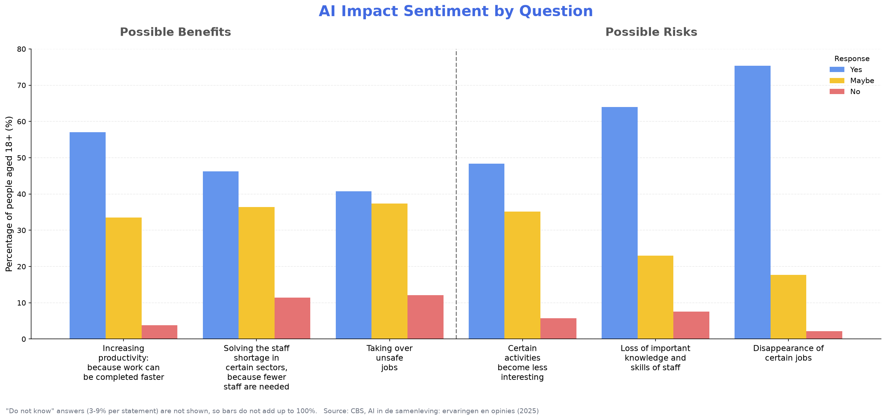
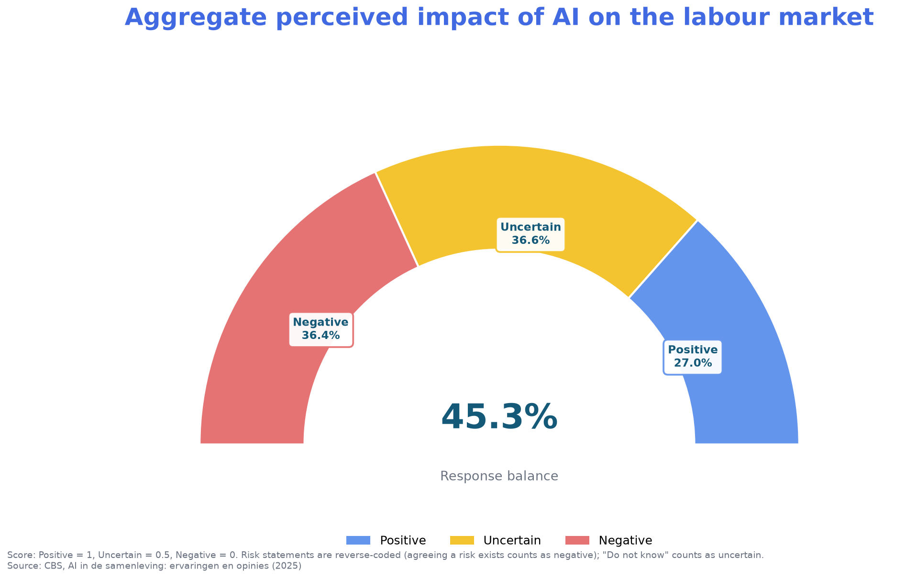
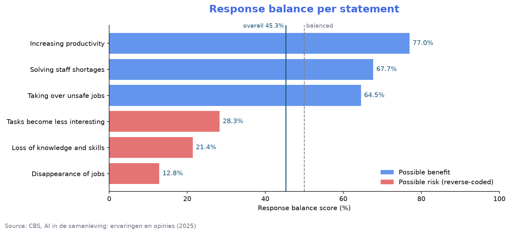
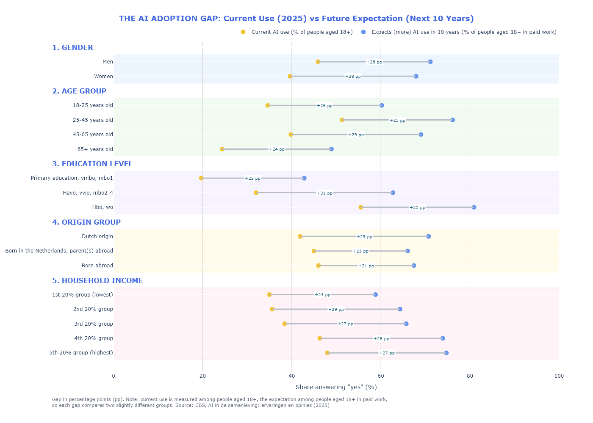
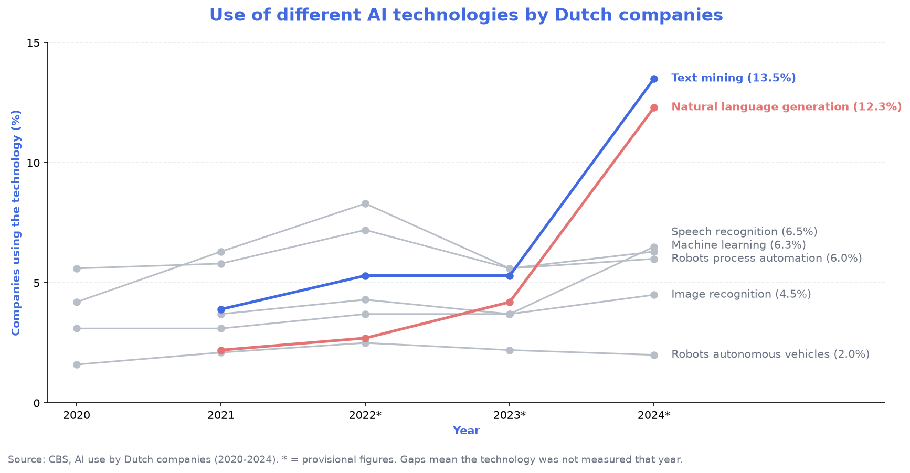
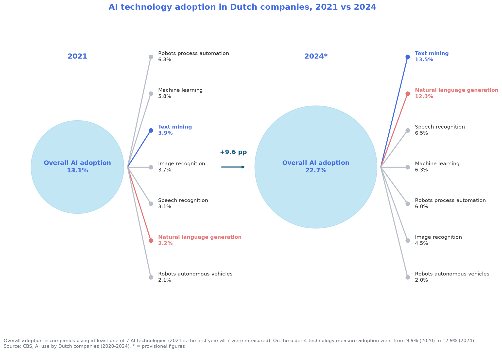

# Perception and Use of Artificial Intelligence in Dutch Labor Market
## Objectives
This project aims to answer two questions: _What is the general perception of AI among the Dutch population?_ and _What is the current and expected use of AI for work among Dutch adults, and the current adoption of AI among Dutch companies?_

This project consists of 3 main stages:
1) **Data Wrangling**: Cleaned and transformed raw survey data using Python/Pandas, handled missing values, reshaped wide-format data into a tidy structure, standardized categorical labels, merged different datasets, and prepared analysis-ready datasets for visualization.
2) **Data Analysis**: Analyzed survey data using Python/Pandas to identify patterns in AI adoption and public perceptions, calculated response proportions, weighted scores, and adoption gaps, and compared AI use across demographic groups and technologies over time.
3)  **Data Visualization**: Created data-driven visualizations using Matplotlib and Plotly, including grouped bar charts, dumbbell charts, time-series plots, and custom comparative graphics to communicate trends, differences, and patterns in AI adoption and perceptions.

## Table of Content
[Dataset used](#dataset-used) <br>
[How to run](#how-to-run) <br>
[Step 1: Data Wrangling](#step-1-data-wrangling) <br>
[Step 2: Data Analysis](#step-2-data-analysis) <br>
[Step 3: Data Visualization & Key Findings](#step-3-data-visualization--key-findings) <br>
[Conclusion](#conclusion) <br>
[Limitations](#limitations)

## Dataset used
This project uses four CBS (Statistics Netherlands) datasets about AI and the labor market:
- **Question 1 dataset.xlsx** and **Question 2 dataset.xlsx**: part of the survey _AI in society: experiences and opinions_ (AI in de samenleving: ervaringen en opinies), conducted among the Dutch population aged 18 and above in 2025. It includes responses from different demographic groups to statements about AI.
- **different AI technologies.csv** and **number of companies - timeline.csv**: the share of Dutch companies using AI, overall and per technology, 2020–2024 (2022–2024 are provisional figures).

More information about the survey can be found on the CBS website: https://www.cbs.nl/nl-nl/publicatie/2026/08/ai-in-de-samenleving-ervaringen-en-opinies

## How to run
```bash
git clone <this repository>
cd Perception-and-Use-of-Artificial-Intelligence-in-Dutch-Labor-Market
python -m pip install -r requirements.txt
python -m notebook "codes/AI_use_in_Dutch_labor_market_Project codes.ipynb"
```

## Step 1: Data Wrangling

**- Reshape the CBS exports into tidy format.** CBS publishes each survey table in wide format: one column per question × answer × measure (estimate, lower bound, upper bound), with the labels spread over several header rows. I turned both survey files into one row per group, question and answer `tidy_cbs_table`. I found the estimate columns by their header label (`Schatting`) instead of by column position, so the code keeps working if CBS adds or reorders columns.

**- Remove empty values & rows.** Blank spacer rows are dropped, and rows that have a label but no numbers are recognised as section headers (e.g. _Gender_, _Age_) and used to label the rows below them.

**- Standardize variables.** Estimates are converted to numbers, and all Dutch questions, answers and demographic labels are translated to English with dictionaries. 

**- Keep track of who was asked.** CBS reports current AI use as a share of _all people aged 18+_, but the 10-year expectation as a share of _people aged 18+ in paid work_. This is kept as a `population` column so the charts can say which group each number describes.

**- Merge the two company datasets on year.** The per-technology and overall adoption tables are joined on year, and years marked `*` are flagged as provisional.

## Step 2: Data Analysis

**- Reverse-code negative questions.** For the three risk statements, "Yes" means the respondent agrees a risk exists. These answers are swapped so that "Yes" always means _positive about AI_. This assumes that rejecting a risk equals a positive view, so the score measures how unworried and optimistic answers are rather than enthusiasm for AI.

**- Calculate response proportions & overall balance.** "Do not know" is counted as uncertain. Each answer is weighted (Positive = 1, Uncertain = 0.5, Negative = 0) to give a balance score where 50% means balanced. The score is calculated overall and per statement, so one number does not hide differences between statements.

**- Calculate the AI adoption gap.** The gap is the difference, in percentage points (pp), between the share expecting to use AI (more) in the next 10 years and the share using it now.

**- Compare like with like.** CBS has two overall company measures: at least one of **4** technologies (from 2020) and at least one of **7** technologies (from 2021). For graph 5, I chose to compare 2021 and the last year (2024), both with 7 technologies for a fair, and equal comparision. 
## Step 3: Data Visualization & Key Findings

### Question 1: What is the general perception of AI among the Dutch population?
#### Graph 1
**Key findings**: Different statements are divided into "Possible Benefits" & "Possible Risks" categories. This chart shows that **Dutch citizens recognize AI's benefits but are more concerned about its potential risks.** The main concerns are **job loss (75.4%)** and **loss of knowledge and skills (64%)**. At the same time, a notable share of respondents answered **"maybe,"** indicating a great amount of uncertainty about AI's impact. "Do not know" answers (3–9% per statement) are not shown.



#### Graph 2
**Key findings**: The distribution of **Dutch citizens' responses leans toward Negative & Uncertain rather than Positive,** with the response balance at **45.3%** (Positive = 1 · Uncertain = 0.5 · Negative = 0).



The per-statement scores (Graph 2b) show that this average hides a clear split: **every benefit statement scores well above balanced (64–77%) and every risk statement well below it (13–28%).** People are not generally lukewarm about AI; they agree with both its benefits and its risks, and the risks weigh slightly heavier.



### Question 2: What is the current and expected use of AI for work among Dutch adults, and the current adoption of AI among Dutch companies?
#### Graph 3
**Key findings**: All demographic groups expect higher use of AI in the next 10 years, with gaps of +21 to +31 pp.

- **Lowest adoption among Primary/VMBO/MBO1**, while **highest among HBO/WO** (56% now → 81% expected).
- **Men currently use AI slightly more than women** (46% vs 40%) and also expect higher future use.
- **Ages 25–45 show the highest adoption** (51%) and strongest future expectations (76%).
- **Higher-income groups use AI the most today** and expect the highest future use (48% → 75% for the top 20%, vs 35% → 59% for the bottom 20%).
- **People born abroad or with parents born abroad use AI slightly more today** (45–46% vs 42% of people of Dutch origin), **but expect less growth** (+21 pp vs +29 pp).

Note: current use is measured among all people aged 18+, the expectation among people aged 18+ in paid work, so each gap compares two slightly different groups. 



#### Graph 4

**Key findings**: The growth of AI adoption between 2021 and 2024 was driven primarily by language-based and generative AI technologies rather than traditional machine learning applications. Text mining became the leading AI technology (13.5%) while Natural Language Generation reached 12.3%, both jumping in 2024. Figures for 2022–2024 are provisional.



#### Graph 5

**Key findings**: Using the same 7-technology definition for both years, **the share of Dutch companies using AI rose from 13.1% in 2021 to 22.7% in 2024 (+9.6 pp, about 1.7×)**. Text mining and natural language generation moved from the bottom half of the list to the top two. On CBS's older 4-technology measure, which leaves out these language technologies, adoption rose only from 9.9% (2020) to 12.9% (2024).



## Conclusion
Dutch adults see AI as both useful and threatening: they mostly agree it raises productivity and helps with staff shortages, but even more strongly expect it to remove jobs and erode skills. At the same time, AI is spreading quickly, both among workers, where every group expects to use it more within 10 years, and among companies, where adoption rose by almost 10 pp in three years, driven by language-based tools.

The groups that use AI least today (lower education, lower income, 65+) also expect some of the smallest increases (+23 to +24 pp), so the current divide is unlikely to close on its own. For **employers**, this points to more thorough AI training for all staffs, specifically aimed at the skills people fear losing; and a more structure and systematic intergration of AI across different departments. specifically aimed at the skills people fear losing. 

## Limitations
- **Provisional figures**: company data for 2022–2024 are provisional and may still be revised by CBS.
- **Change in definition**: the overall company measure changed from 4 to 7 technologies in 2021; only same-definition figures are compared.
- **Different groups**: current AI use and expected future use are measured for different populations (all adults vs adults in paid work).
- **Self-reported data**: AI use and expectations are what respondents report, which may differ from actual use (for example, people may not recognise AI built into the tools they use).
- **Scoring choices**: the response balance score depends on the reverse-coding and on weighting "Maybe" and "Do not know" as 0.5.
